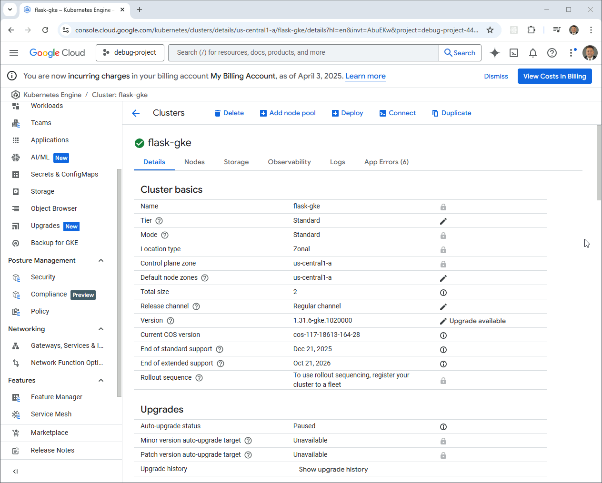
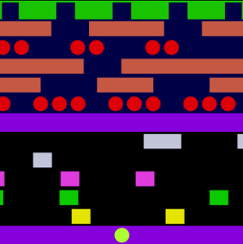
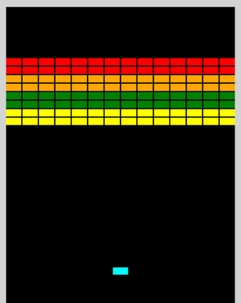

# Kubernetes on GCP: GKE with NGINX Ingress, Artifact Registry and Firestore

Video 3 of the [Kubernetes in the Cloud](https://github.com/mamonaco1973/cloud-k8s-intro/blob/main/README.md)
series. The candidate microservice from
[GCP Managed Instance Groups](https://github.com/mamonaco1973/gcp-flask-mig) and
[Simple GCP Containers](https://github.com/mamonaco1973/gcp-flask-container)
runs here on **Google Kubernetes Engine**, next to three browser games
(Tetris, Frogger and Breakout). Images live in **Artifact Registry**, the
Flask pods store candidates in **Firestore** through Workload Identity, and
an **NGINX ingress controller** behind one load balancer routes to
everything. Terraform builds the infrastructure and the ingress controller;
`kubectl` deploys the apps.



| Piece | Where | Role |
|---|---|---|
| **gke-vpc** | `us-central1` | subnet `gke-subnet` (`10.20.0.0/16`); Cloud Router and NAT (`gke-nat`) for outbound traffic from the private nodes |
| **flask-gke** | GKE, zonal, `us-central1-a` | private nodes (no public IPs); Workload Identity pool `<project>.svc.id.goog` |
| **default-node-pool** | GKE | `e2-standard-4`, 1 to 4 nodes with autoscaling; runs `flask-app` |
| **game-node-pool** | GKE | `e2-standard-4`, 1 node, labelled `nodegroup=game-nodes`; runs the games in the `games` namespace |
| **nginx-ingress** | Helm, `ingress-nginx` | NGINX ingress controller; its `LoadBalancer` service gets an external network load balancer |
| **flask-app** | Deployment | 2 replicas, scaled 2 to 5 by an HPA at 60% CPU; `/gtg` probes; service account `firestore-access-sa` |
| **tetris**, **frogger**, **breakout** | Deployments, `games` | one replica each |
| **Firestore** | `(default)`, native mode | `candidates` collection; created by `api_setup.sh` |
| **Google service account** | IAM | `roles/datastore.user`; `firestore-access-sa` impersonates it through `roles/iam.workloadIdentityUser` |
| **flask-repository**, **games-repository** | Artifact Registry, `us-central1` | the images |

## Architecture

<picture>
  <source media="(prefers-color-scheme: dark)" srcset="architecture-dark.svg">
  
</picture>

Regenerate with `python3 make_diagram.py`.

- **`01-gar/`**: the two Artifact Registry repositories.
- **`02-docker/`**: the Flask app and the three games, each with its
  `Dockerfile`, plus the `test_candidates.py` smoke test.
- **`03-gke/`**: the network and NAT, the cluster and both pools, the
  Workload Identity binding (`security.tf`), the NGINX Helm release, and the
  manifest templates in `yaml/`.
- **`stress.yaml`**: a CPU load generator for the autoscaling test.

## Endpoints

| Path | Returns |
|---|---|
| `GET /flask-app/api/gtg` | 200; with `?details=true`, connection details |
| `GET /flask-app/api/<name>` | the candidate, or 404 |
| `POST /flask-app/api/<name>` | `{"CandidateName": <name>}`, or 500 |
| `GET /flask-app/api/candidates` | every candidate, or 404 |
| `GET /games/tetris` | Tetris |
| `GET /games/frogger` | Frogger |
| `GET /games/breakout` | Breakout |

The games are [Tetris](https://gist.github.com/straker/3c98304f8a6a9174efd8292800891ea1),
[Frogger](https://gist.github.com/straker/82a4368849cbd441b05bd6a044f2b2d3)
and [Breakout](https://gist.github.com/straker/98a2aed6a7686d26c04810f08bfaf66b)
by Steven Lambert, served by NGINX.

| Tetris | Frogger | Breakout |
|---|---|---|
|  |  |  |

## Prerequisites

* [A Google Cloud Account](https://console.cloud.google.com/)
* [Install gcloud CLI](https://cloud.google.com/sdk/docs/install)
* [Install Terraform](https://developer.hashicorp.com/terraform/install)
* [Install Docker](https://docs.docker.com/engine/install/) with `buildx`
* [Install kubectl](https://kubernetes.io/docs/tasks/tools/) and
  [jq](https://jqlang.github.io/jq/download/)

Put a service account key in the repository root as `credentials.json`. If
this is your first time watching our content, we recommend starting with
this video: [GCP + Terraform: Easy Setup](https://www.youtube.com/watch?v=3spJpYX4f7I).

## Deploy

```bash
git clone https://github.com/mamonaco1973/gcp-k8s.git
cd gcp-k8s
./apply.sh
```

`check_env.sh` signs in with `credentials.json` and runs `api_setup.sh`,
which enables the APIs and creates the Firestore database. `apply.sh` then:

1. Applies **`01-gar`** (the repositories).
2. Configures Docker for `us-central1-docker.pkg.dev` and builds and pushes
   the Flask image and the three game images.
3. Applies **`03-gke`**: the network, cluster, pools, Workload Identity
   binding and the NGINX ingress.
4. Gets credentials for `kubectl`, renders `flask-app.yaml` and `games.yaml`
   with the project ID, and applies them.

It ends by running `validate.sh`, which waits for the ingress to get an IP
and for `/flask-app/api/gtg` to answer, then runs the smoke test:

```
NOTE: URL for GKE Deployment is http://<ingress IP>/flask-app/api/gtg?details=true
✓ good to go passed
✓ insert passed
✓ verification passed
✓ candidate list passed
```

## Try it

1. Open `http://<ingress IP>/games/tetris` (or `frogger`, `breakout`) in a
   browser, and call the Flask API with `curl` or Postman.
2. Check the workloads:

   ```bash
   kubectl get pods,deployments,ingress
   kubectl get pods,deployments,ingress -n games
   kubectl get nodes
   ```

3. Test autoscaling. `stress.yaml` runs 4 replicas of a CPU load generator:

   ```bash
   kubectl apply -f stress.yaml
   # wait about 5 minutes
   kubectl get nodes          # the default pool grows, up to 4 nodes
   kubectl delete -f stress.yaml
   # wait about 5 minutes
   kubectl get nodes          # and shrinks back
   ```

## Teardown

```bash
./destroy.sh
```

## Is GKE PaaS or IaaS?

Both, in layers. Google runs the control plane, and you describe node pools
instead of building VMs, which feels like PaaS. Underneath, each pool is a
Compute Engine managed instance group, the autoscaler changes its size, and
a `Service` of type `LoadBalancer` becomes a forwarding rule and target pool.
Labels tie resources back to the cluster. GKE sits between fully managed
services such as Firestore and plain VMs: control when you want it,
automation when you don't.

## Notes

- **Lab only.** The API and games are open to the internet over plain HTTP.
- The node pools don't set a service account, so nodes run as the default
  Compute Engine service account with the `cloud-platform` scope.
